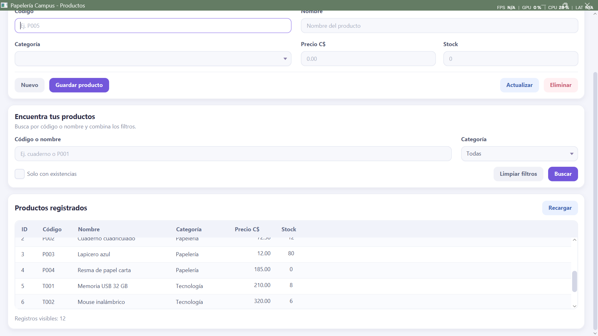
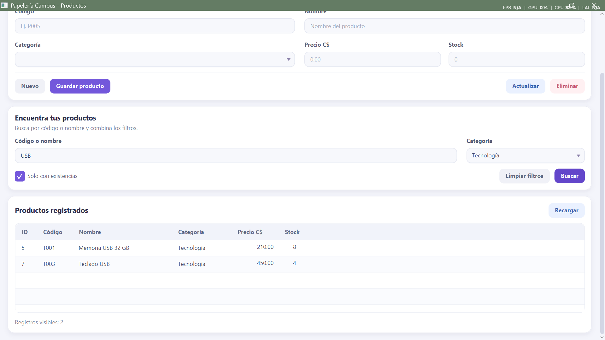
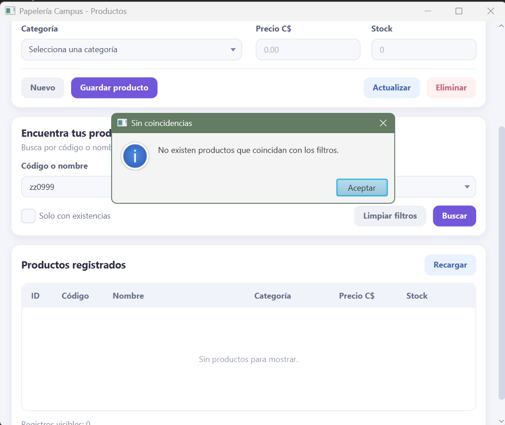
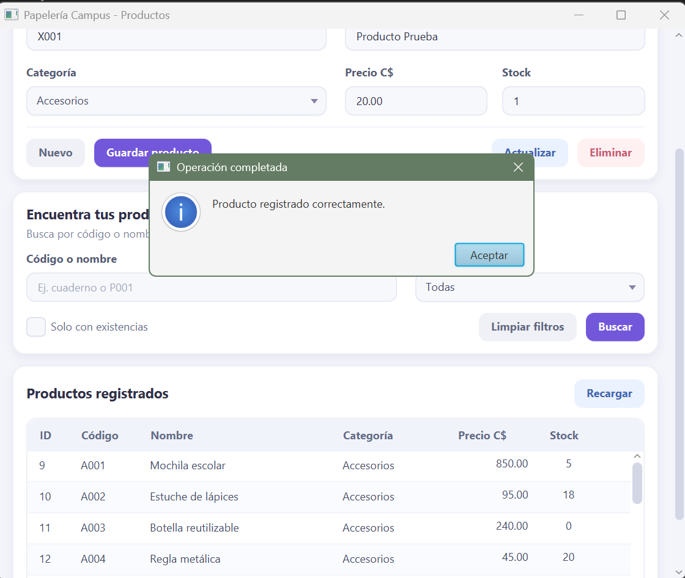
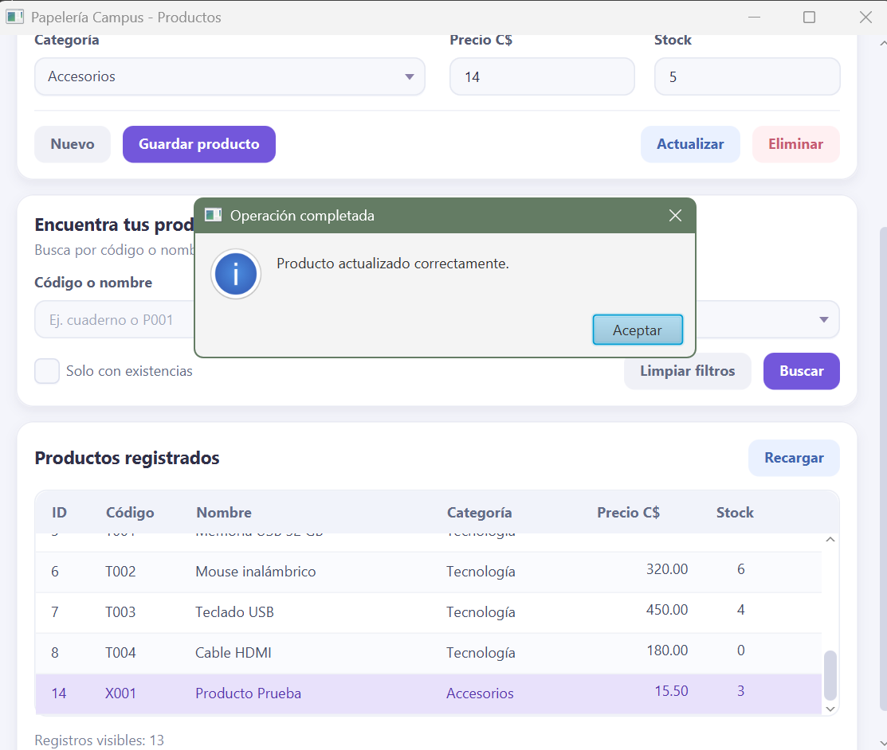
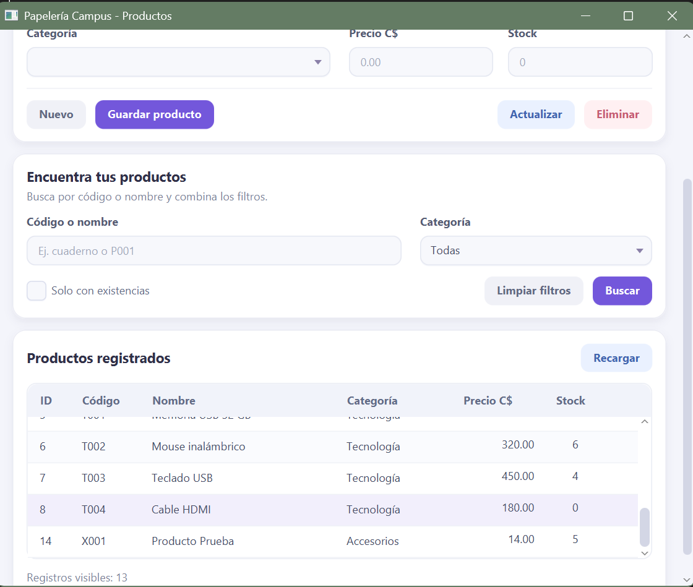
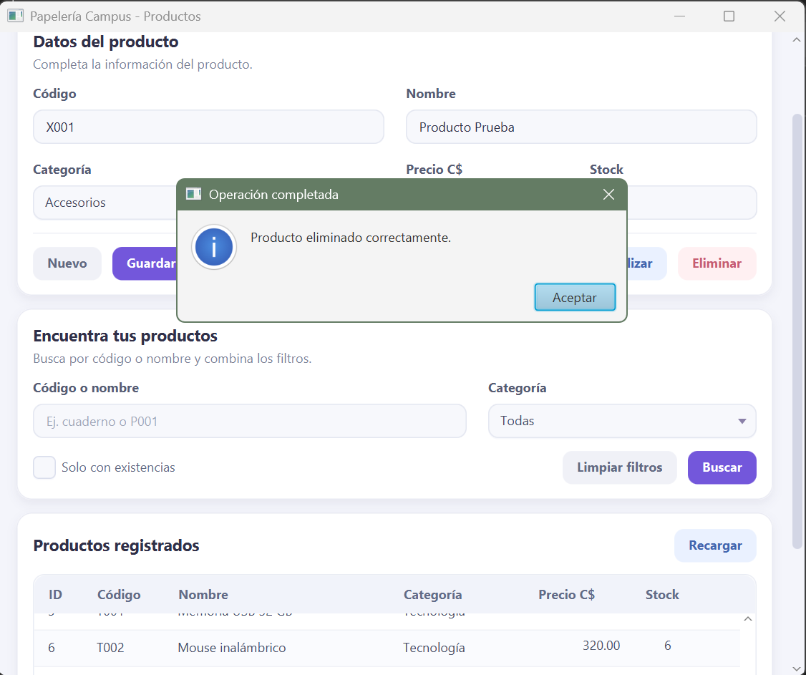
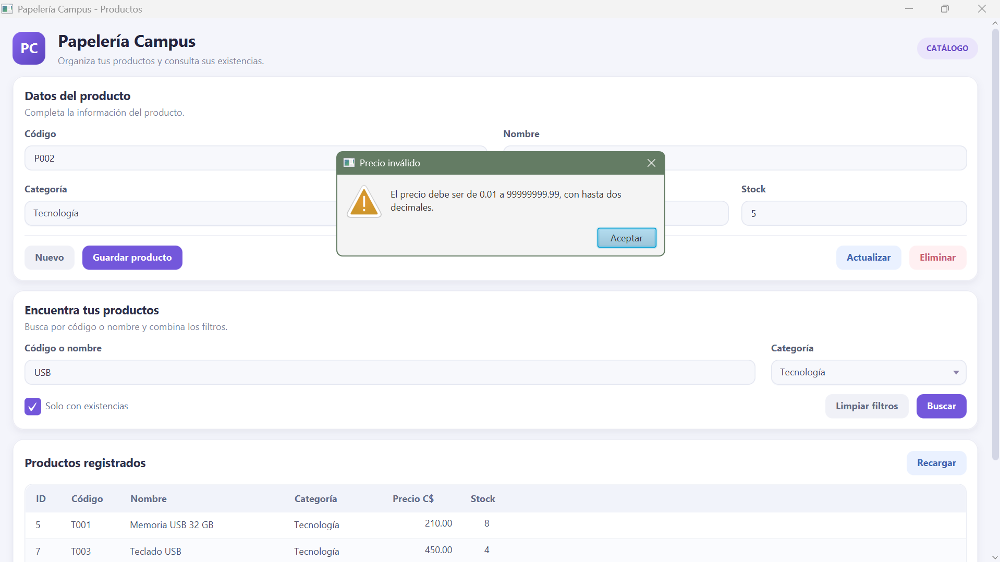
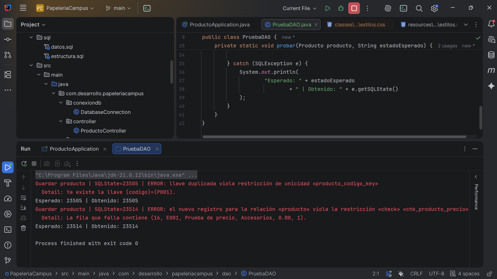

# Pruebas de Papelería Campus

Base de datos: `papeleria_campus`  
Tabla: `catalogos.producto`

Las pruebas se realizaron sobre una base local. Se comprobaron los resultados en la aplicación y, cuando correspondía, mediante consultas en PostgreSQL y al reiniciar el programa.

Se incluyen capturas de algunas pruebas. Los demás resultados se registran por escrito.

## Listado y recarga

| Prueba | Resultado esperado | Resultado obtenido | Estado |
|---|---|---|---|
| Abrir la aplicación | Mostrar los 12 productos, las seis columnas y el contador en 12. Ordenar por código. | Se mostraron los datos y el contador correctamente. | Aprobada |
| Seleccionar una fila | Cargar sus datos en el formulario sin permitir editar el ID. | Los campos mostraron los datos del producto seleccionado. | Aprobada |
| Recargar después de agregar un producto desde PostgreSQL | Mostrar el nuevo registro sin reiniciar. | El registro apareció al pulsar Recargar. Se retiró al terminar la prueba. | Aprobada |

## Búsqueda y filtros

Antes de cada caso se limpiaron los filtros, excepto en B7.

| Caso | Entrada | Resultado esperado | Resultado obtenido | Estado |
|---|---|---|---|---|
| B1 | Texto CUADERNO | P001 y P002; contador 2. | Aparecieron ambos productos y el contador mostró 2. | Aprobada |
| B2 | Texto T00 | T001 a T004; contador 4. | Aparecieron los cuatro productos. | Aprobada |
| B3 | Categoría Papelería | P001 a P004; contador 4. | Se mostraron únicamente los cuatro productos de Papelería. | Aprobada |
| B4 | Solo con existencias y categoría Todas | 9 productos; excluir P004, T004 y A003. | Se mostraron 9 productos y se excluyeron los tres sin existencias. | Aprobada |
| B5 | USB, Tecnología y Solo con existencias | T001 y T003; contador 2. | Se mostraron únicamente T001 y T003. | Aprobada |
| B6 | Texto ZZZ999 | Tabla vacía, contador 0 y aviso Sin coincidencias. | Se obtuvo el resultado esperado. También se comprobó con el texto zz0999 mostrado en la captura. | Aprobada |
| B7 | Limpiar filtros después de B5 | Texto vacío, categoría Todas, casilla desmarcada y 12 registros. | Los controles y el listado se restablecieron correctamente. | Aprobada |

### Filtro combinado

### Búsqueda sin coincidencias

## Operaciones CRUD

Las pruebas principales se realizaron con los filtros limpios.

| Prueba | Resultado esperado | Resultado obtenido | Estado |
|---|---|---|---|
| Guardar X001, Producto de prueba, Accesorios, precio 10.00 y stock 1 | Registrar el producto y mostrar 13 filas. | El registro se guardó y el contador aumentó a 13. | Aprobada |
| Seleccionar X001 | Mostrar sus datos en el formulario. | El formulario mostró los valores del registro seleccionado. | Aprobada |
| Actualizar X001 a precio 15.50 y stock 3 | Cambiar únicamente X001 y conservar 13 filas. | Se modificó el producto seleccionado sin alterar los demás. | Aprobada |
| Cancelar la eliminación de X001 | Conservar el producto y las 13 filas. | La cancelación no modificó la base de datos. | Aprobada |
| Confirmar la eliminación de X001 | Eliminar únicamente X001 y volver a 12 filas. | El producto desapareció y quedaron los 12 registros iniciales. | Aprobada |
| Consultar PostgreSQL y reiniciar después de cada operación | Conservar los cambios realizados. | La base de datos y la aplicación mantuvieron los resultados esperados. | Aprobada |
| Actualizar un producto con filtros activos | Mantener los filtros y retirar del listado los registros que dejen de cumplirlos. | El listado se actualizó respetando los filtros. | Aprobada |

Las capturas incluyen ensayos adicionales con precio 20.00 al guardar y con precio 14.00 y stock 5 al actualizar. Estos ensayos complementan el ciclo principal indicado en la tabla.

### Guardar

### Actualizar

### Eliminar

## Validaciones

Se comprobaron al guardar y actualizar, cuando correspondía. Los intentos rechazados no modificaron la base de datos.

| Caso | Entrada o acción | Resultado esperado | Resultado obtenido | Estado |
|---|---|---|---|---|
| V1 | Código vacío, solo espacios y 11 caracteres | Rechazar los tres casos. | Se rechazaron y se indicó la longitud permitida. | Aprobada |
| V2 | Nombre con espacios, AB y 81 caracteres | Exigir entre 3 y 80 caracteres después de quitar espacios laterales. | Se rechazaron los tres casos. | Aprobada |
| V3 | Categoría sin seleccionar | Solicitar una categoría válida. | Se impidió guardar o actualizar sin categoría. | Aprobada |
| V4 | Precio abc | Mostrar un aviso sin cerrar la aplicación. | Se informó que el precio debe ser numérico. | Aprobada |
| V5 | Precio 0 y -1 | Rechazar ambos. | Ambos valores fueron rechazados. | Aprobada |
| V6 | Precio 12.345 y 100000000.00 | Rechazar exceso de decimales y de rango sin redondear. | Ambos valores fueron rechazados. | Aprobada |
| V7 | Stock abc y 2.5 | Rechazar valores que no sean enteros. | Ambos valores fueron rechazados. | Aprobada |
| V8 | Stock -1, 2147483648 y 0 | Rechazar los dos primeros y permitir 0. | Se rechazaron los valores inválidos y se aceptó stock cero. | Aprobada |
| V9 | Crear otro producto con código « p001 » y actualizar otro a P001 | Rechazar duplicados después de normalizar. Permitir conservar el código del propio producto. | Se rechazaron los duplicados y se permitió conservar el código propio. | Aprobada |
| V10 | Actualizar o eliminar sin seleccionar una fila | Bloquear la operación y solicitar una selección. | Se mostró el aviso y no hubo cambios. | Aprobada |

## Manejo de errores

| Caso | Prueba | Resultado esperado | Resultado obtenido | Estado |
|---|---|---|---|---|
| E1 | Configurar temporalmente un puerto incorrecto | Mostrar un error comprensible sin cerrar la aplicación ni presentar el fallo como una consulta vacía exitosa. | Se mostró el aviso y se identificó el fallo de carga. Después se restableció el puerto correcto. | Aprobada |
| E2 | Intentar guardar desde el DAO un código repetido y un precio cero | PostgreSQL debe rechazar las operaciones y conservar los datos. | Se obtuvieron SQLState 23505 y 23514, respectivamente. | Aprobada |
| E3 | Eliminar un producto temporal desde PostgreSQL e intentar actualizarlo o eliminarlo desde la aplicación | Advertir que no hubo filas afectadas y permitir recargar. | Se informó que no hubo cambios y se actualizó el listado. | Aprobada |
| E4 | Revisar los errores de las operaciones anteriores | Registrar la operación y el SQLState; mostrar avisos sin contraseñas ni trazas técnicas y evitar mensajes falsos de éxito. | La consola registró el diagnóstico y la aplicación mostró los avisos correspondientes. | Aprobada |

## Comprobaciones de la actualización

| Prueba | Resultado esperado | Resultado obtenido | Estado |
|---|---|---|---|
| Conexión mediante variables de entorno | La aplicación carga los productos usando DB_URL, DB_USER y DB_PASSWORD. | Pendiente de comprobar en esta versión. | Pendiente |
| Variable ausente | Al retirar DB_PASSWORD, aparece un aviso y la consola identifica la configuración faltante. | Pendiente | Pendiente |
| Categorías del formulario | El ComboBox muestra las tres categorías asociadas a los productos iniciales. | Pendiente | Pendiente |
| Categorías del filtro | Muestra Todas y las categorías obtenidas mediante INNER JOIN. | Pendiente | Pendiente |
| Listado y búsqueda combinada | Se conservan los 12 productos iniciales; USB + Tecnología + existencias devuelve T001 y T003. | Pendiente | Pendiente |
| CRUD después de la actualización | Guardar, actualizar y eliminar el producto temporal funciona y respeta los filtros. | Pendiente | Pendiente |
## Estado final

Se retiraron los productos temporales utilizados durante las pruebas y se conservaron los 12 registros iniciales.